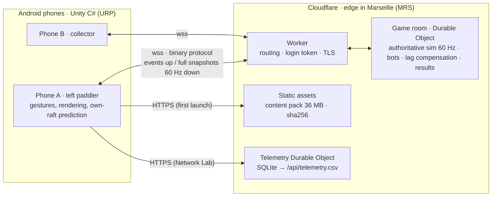
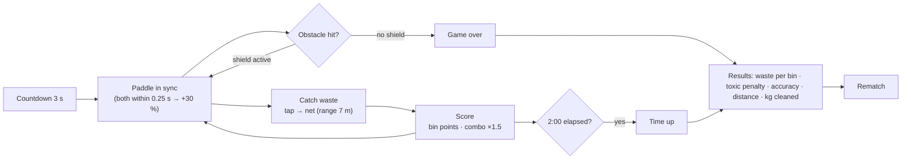
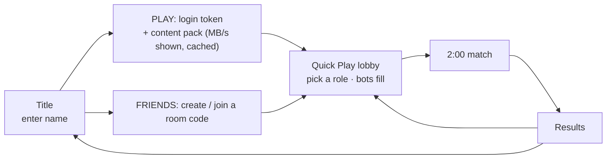
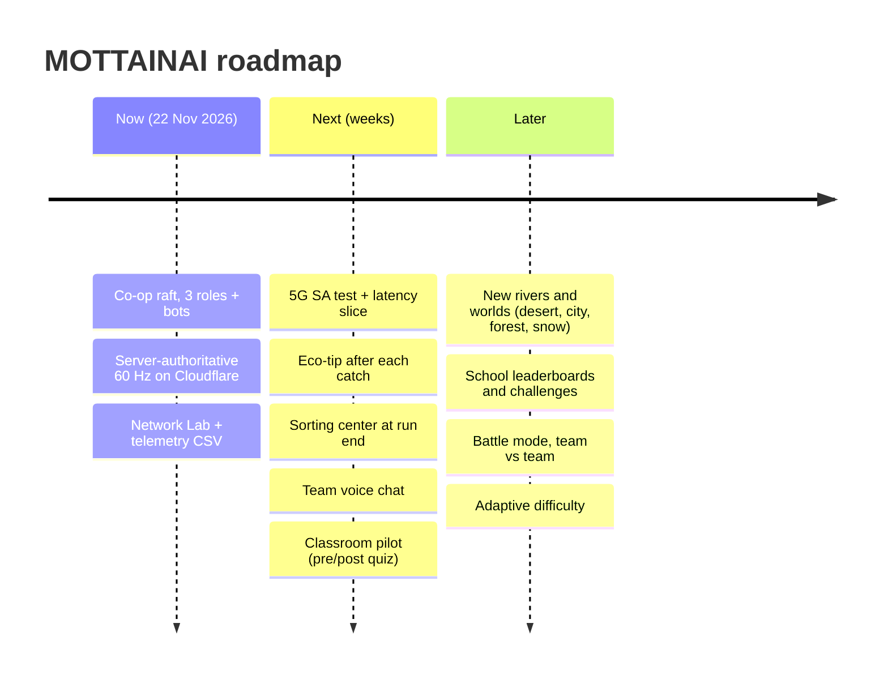

# MOTTAINAI — final jury presentation guide

Deck: `Pitch/MOTTAINAI_Final.pptx` (backup: `Pitch/MOTTAINAI_Final.pdf`). Built by `Pitch/build_final.js`. Sections B, C and E below are generated from the deck itself, so they always match it.

Inputs merged:
- **Presentation A:** `Pitch/MOTTAINAI_Pitch.pptx` (22 Nov 2026, English, 12 slides + 1 hidden, built from the code).
- **Presentation B:** `Downloads/Green Hackathon - THE PITCH - Mottainai (1).pptx` (2 Nov 2026, French, 10 slides, hackathon application form). The other copy without "(1)" is an older draft with "[Nom de l'équipe]" placeholders; the "(1)" version is the newer one (team name filled in).
- **The code and logs** in this repo (source of truth for every number).

---

## A. Comparative analysis

**Presentation A: strengths**
- One clear story (sea → rivers → kids → game → demo → tech → 5G → impact), verified stats with sources (WWF 2019, OECD 2022).
- Every game number comes from `server/src/tuning.json`; latency numbers are real measurements.
- Real architecture (WebSocket → Cloudflare → Durable Object), a timed word-for-word script, a demo plan and Plan B.
- Consistent visual identity, real screenshots.

**Presentation A: weaknesses**
- 12 slides for ~4 minutes: some slides are thin. The voice slide spends 15 s on a feature that does not exist; the data slide shows a bot-only match.
- Engineering appears only as keywords. The challenges and the decisions behind them are not told.
- Impact is a list of next steps, with no plan to measure learning.
- No team name, no story of how the idea evolved, and a 1:00 demo (the new brief asks for 30–45 s).

**Presentation B: strengths**
- Strong education angle: target ages 7–12 ("the age when good habits form"), a safety rule (never touch hazardous waste bare-handed), habits at home.
- Impact framed for the child: an eco-tip at the right moment, an end-of-run report ("he sees that his actions count").
- Data idea worth keeping: log every catch to find which waste kids confuse most.
- Connectivity ideas: online leaderboard, challenges between friends and schools; AI that adapts difficulty.
- Team identity: team name **5le9a Deyra**, school, four telecom engineering students. A 30-second elevator pitch.

**Presentation B: weaknesses**
- It is a questionnaire (checkboxes, long paragraphs), in French, with almost no visuals (only the hackathon poster).
- It describes the **application concept, not the prototype**: a solo 3-lane endless runner across 4 worlds.
- No architecture, no numbers, multiplayer unchecked.

**Redundant in both:** title/elevator pitch, the end-of-run report, eco-tips, impact statements. Merged into one idea slide, one loop slide and one impact slide.

**Contradictions, resolved with the code as evidence**

| Topic | B (application, 2 Nov) | A / code (prototype, 22 Nov) | Final deck |
|---|---|---|---|
| Genre | Solo 3-lane endless runner | 3-player co-op raft on a river | Co-op raft; the evolution is told on slide 3 |
| Worlds | Desert, city, forest, snow | One river course (~650 m) | One river now; new rivers and worlds are **Later** |
| Waste | 4 families (+10/+15/+30/very toxic) | 7 bin colors (+10…+100, toxic −30 at the end) | 7 bin colors |
| Lives | 2 hearts | 1 hit = game over | 1 hit |
| Shield | Eco-Shield 15 s | Shield 6 s (+ magnet, turbo) | 6 s |
| Multiplayer | Not planned | Real-time, 3 seats, bots fill | Implemented |
| Sorting center at run end | Core feature | Not in code | **Next** |
| Eco-tips per catch | Core feature | Not in code (README claims it) | **Next** |
| Analytics "which waste kids confuse" | Planned | Only network telemetry is stored; gameplay results are shown, not stored | Measurement **plan** |
| Network | Online leaderboard | WebSocket (README still says UDP 7777 / NGO: outdated) | WebSocket on Cloudflare |

**Missing in both, added to the final deck**
- The engineering challenges and the decisions they forced (slide 8).
- A plan to measure impact without inventing results (slide 9).
- A clear "implemented vs Next vs Later" split (slides 9 and 11 of A were mixed).
- Measured performance with sources (slide 8), security and privacy answers (section G), a backup video (hidden slide).

**Claims to verify before the jury (flagged, not invented)**
1. The reason for the pivot from runner to co-op ("cleaning a river is teamwork"): confirm the team agrees with this wording.
2. The team name on screen: "5le9a Deyra" (as written in B). Check spelling and how to say it.
3. "60 fps" is one test phone (merge check, 60.1 fps average, worst frame 33.2 ms), not every phone.
4. "43 ms" was measured from a PC test client to a Marseille room; "71 ms" is a phone on Wi-Fi to the Paris room. There is **no 5G SA measurement yet**.
5. The banner and slide 1 art are concept art, not in-game captures (labelled on slide 3).
6. Tunisia-specific plastic figures were **not used**: the WWF sources disagree with each other.
7. The speaker split and who holds Phone B in the demo.

**What was kept, merged, dropped**
- Kept from A: hook stat, rivers stat, roles + sync boost, rules, demo slide, architecture, measured latency, closing line.
- Kept from B: team name, ages 7–12, the safety reflex, eco-tips and sorting center (as Next), leaderboards / school challenges, worlds and adaptive difficulty (as Later), the "which waste kids confuse" idea (as a measurement plan).
- Merged: A's rules + data slides → one gameplay-loop slide; A's 5G slide → measurements on the engineering slide + roadmap; A's impact + next steps → one impact-and-roadmap slide.
- Dropped: A's voice slide (feature not built: now one roadmap line), A's bot-match chart, B's checkbox pages, B's specialties list.

---

## B. Final presentation structure

| # | Slide | Act | Time | Speaker |
|---|---|---|---|---|
| 1 | The sea is choking | I Problem | 0:20 | Yassine AFFES |
| 2 | Plastic starts upstream | I Problem | 0:20 | Yassine AFFES |
| 3 | MOTTAINAI | II Idea | 0:20 | Wajdi ZENTANI |
| 4 | Three roles, one raft | III Experience | 0:25 | Wajdi ZENTANI |
| 5 | The gameplay loop | III Experience | 0:20 | Wajdi ZENTANI |
| 6 | Live demo | V Proof | 0:45 | Rayen TOUIL |
| 6b | Demo backup (hidden) (hidden) | V Proof (backup) | — | Rayen TOUIL |
| 7 | One authoritative game room per match | IV Engineering | 0:25 | Rayen TOUIL |
| 8 | Engineering challenges we solved | IV Engineering | 0:30 | Rayen TOUIL |
| 9 | Impact and roadmap | VI Impact | 0:30 | Med Amine CHAKROUN |
| 10 | Closing | VI Impact | 0:15 | Med Amine CHAKROUN |

Planned time: **4:10** for 10 slides. Script at 140 words/min: 453 spoken words (3:14) + 0:45 demo = **3:59**, leaving about 1:01 of margin inside the 5:00 limit.

---

## C. Complete slide content

### 1. The sea is choking — 0:20 — Yassine AFFES

- **Text on the slide:**
  - THE MEDITERRANEAN · EVERY YEAR
  - 570,000 tonnes of plastic
  - ≈ 33,800 plastic bottles every minute
  - What if kids could fix it — by playing?
  - Source: WWF, Stop the Flood of Plastic (2019)
- **Visual composition:** Full-bleed MOTTAINAI concept art (river flowing to the sea) under a 78 % deep-teal veil; huge white number top-left, coral sub-line, question at mid-height with 'by playing?' in green.
- **Images:** Docs/reference_v3_master.jpg
- **Animation / transition:** Fade in. Optional: number appears first, question on click.
- **Speaker notes:** Every year, five hundred seventy thousand tonnes of plastic enter the Mediterranean. That's almost thirty-four thousand bottles every minute, right on our doorstep. We are 5le9a Deyra, four telecom engineering students from SUP'COM. And we asked one question: what if kids could fix this, by playing? [CLICK]

### 2. Plastic starts upstream — 0:20 — Yassine AFFES

- **Text on the slide:**
  - Plastic starts upstream
  - 109 Mt of plastic already sit in the world's rivers
  - Source: OECD, Global Plastics Outlook (2022)
  - Streets → Rivers → Sea
  - Ages 7–12: when habits form
  - Sorting is taught, rarely practised
- **Visual composition:** Left: giant stat. Right: three icon circles linked by arrows (streets, rivers, sea), then two white cards with icons (child, teacher).
- **Images:** icons only
- **Animation / transition:** Fade. Cards appear after the stat (optional).
- **Speaker notes:** This plastic doesn't start at sea. It starts in our streets and rivers. The OECD counts one hundred nine million tonnes sitting in rivers. Seven to twelve is when habits form. But sorting is taught in lectures, and lectures don't stick. Kids learn by doing. [CLICK] [HAND OVER TO WAJDI]

### 3. MOTTAINAI — 0:20 — Wajdi ZENTANI

- **Text on the slide:**
  - MOTTAINAI
  - もったいない · “What a waste!”
  - A real-time co-op mobile game: 3 players, 1 raft, 1 polluted river.
  - How the idea evolved: Application — solo runner → Prototype — 3-player co-op raft
  - Concept art (target look)
- **Visual composition:** Deep-teal slide. Left: wordmark, Japanese meaning, one-liner, evolution chips. Right: the animated banner GIF (concept art) with bin-color dots under it.
- **Images:** Docs/media/mottainai_banner.gif
- **Animation / transition:** Fade. The GIF animates in PowerPoint.
- **Speaker notes:** So we built MOTTAINAI. In Japanese, it means 'what a waste!'. Our first idea was a solo runner. We turned it into a cooperative game, because cleaning a river is teamwork. Three players share one raft. Nobody wins alone. [CLICK]

### 4. Three roles, one raft — 0:25 — Wajdi ZENTANI

- **Text on the slide:**
  - Three roles, one raft
  - Left paddler — Swipe ↓ paddle · ↑ brake
  - Right paddler — Swipe ↓ paddle · ↑ brake
  - Collector — Tap waste: throw the net
  - +30 % SYNC BOOST — both paddlers stroke within 0.25 s
  - Missing players? Bots fill the seats.
  - Caption: Real phone during a full match (collector view)
- **Visual composition:** Left: real phone screenshot of a match. Right: three role rows (icon circle, name, gesture). Bottom: deep-teal band with the +30 % sync boost and the bot note.
- **Images:** Docs/art_v3/merge_phone.png
- **Animation / transition:** Fade. Optional: role rows appear one by one on click.
- **Speaker notes:** Here's how it plays. The left paddler swipes down to push forward and turn right. The right paddler does the opposite. The collector taps floating waste to throw a net. When both paddlers stroke within a quarter second, the raft gets a sync boost: thirty percent more thrust. Missing a friend? A bot takes the seat. [CLICK]

### 5. The gameplay loop — 0:20 — Wajdi ZENTANI

- **Text on the slide:**
  - The gameplay loop
  - Paddle in sync (swipe together) → Catch waste (tap → net) → Score (bin color · combo ×1.5) → Survive (1 hit = game over)
  - ↻ Repeat for 2:00 · power-ups: shield 6 s, magnet, turbo
  - Plastic +10 · Paper +10 · Glass +15 · Organic +5 · Metal +20 · Valuable +100 · Toxic −30
  - End of run → waste per bin · accuracy · kg of river cleaned
- **Visual composition:** Four icon nodes linked by arrows, a repeat line, the seven bin-color circles with points, and a deep-teal results band.
- **Images:** icons only
- **Animation / transition:** Fade. Optional: nodes appear left to right.
- **Speaker notes:** Each run lasts two minutes. Catch waste, and each bin color scores. Chain three catches for a combo. One hit on a rock or a shark ends the run. Toxic waste costs points: you learn not to touch it. Then you see the kilos you cleaned. [CLICK] [HAND OVER TO RAYEN]

### 6. Live demo — 0:45 — Rayen TOUIL

- **Text on the slide:**
  - LIVE DEMO
  - 2 phones + 1 bot · real time over Cloudflare at 60 Hz
  - 1 Start — roles already picked
  - 2 Paddle in sync — watch the boost
  - 3 Catch waste — bin colors score
  - 4 Results — kg of river cleaned
- **Visual composition:** Deep-teal stage slide: big spaced title, sub-line, four numbered steps (the demo script the jury can follow).
- **Images:** icons only
- **Animation / transition:** Fade, then switch the projector to the mirrored phone.
- **Speaker notes:** Let's prove it live. [START DEMO] Two phones, one bot. I'm the left paddler; Wajdi is the collector. Watch: when we stroke together, the raft surges. Wajdi taps a bottle, the net flies, and it scores. The server runs all of this sixty times a second. [~25 s of play, then steer into a rock] Rock ahead... game over. And here is our result: waste per bin, accuracy, and kilos of river cleaned. [CLICK]

### 6b. Demo backup (hidden) (hidden, Plan B) — — — Rayen TOUIL

- **Text on the slide:**
  - Demo backup
  - Gameplay · Lobby · Results (real screenshots)
  - Backup video: Pitch/media/demo_backup.mp4
- **Visual composition:** Hidden slide: big phone gameplay shot, lobby and results shots, chips labelling each.
- **Images:** Docs/art_v3/merge_phone.png, Docs/art_v3/P5_pc_lobby.png, Docs/art_v3/P5_pc_results.png
- **Animation / transition:** None.
- **Speaker notes:** Plan B only. The network is not on our side today, so here is the same match: the lobby where each phone picks a role, the river in play, and the results with waste per bin and kilos cleaned. [type 8 + Enter]

### 7. One authoritative game room per match — 0:25 — Rayen TOUIL

- **Text on the slide:**
  - One authoritative game room per match
  - Phone 1/2/3 · Unity
  - wss · binary
  - Cloudflare · edge in Marseille (MRS)
  - Worker — routing · login token · TLS
  - Game room — Durable Object · 60 Hz sim · bots · lag compensation
  - Content pack — 36 MB static assets, sha256
  - Telemetry — SQLite → /api/telemetry.csv
  - Events up · 60 Hz snapshots down · Server decides · TLS + random tokens
- **Visual composition:** Architecture diagram: three phone nodes on the left, a light-turquoise Cloudflare zone holding the Worker, the game-room Durable Object, the content pack and the telemetry store; chips underneath.
- **Images:** icons only
- **Diagram:** See section D, diagram 1.
- **Animation / transition:** Fade. Optional: phones, then Worker, then room appear on click.
- **Speaker notes:** Under the hood: three Unity phones connect over secure WebSockets to Cloudflare's edge in Marseille. Each match runs in its own game room, a Durable Object that owns the game state: it simulates the river sixty times a second, runs the bots and streams full snapshots back. Phones send only events, like a stroke or a net throw. [CLICK]

### 8. Engineering challenges we solved — 0:30 — Rayen TOUIL

- **Text on the slide:**
  - Engineering challenges we solved
  - No UDP for games on Cloudflare → compact binary protocol over WebSockets (TLS), events-only uplink
  - A 0.25 s sync window → own-raft prediction, adaptive jitter buffer, lag compensation ≤ 150 ms
  - Fair play → server-authoritative: phones only send strokes and net throws
  - 60 Hz snapshots to every phone · 226 kbps download per phone · 43–71 ms round trip, measured · 60 fps average on a test phone
  - Source line with dates
- **Visual composition:** Three white challenge cards (coral PROBLEM label, bold problem, muted answer) above four big-number tiles and a small source line.
- **Images:** icons only
- **Animation / transition:** Fade. Optional: metrics row appears on click.
- **Speaker notes:** Three challenges. One: Cloudflare gives us no UDP, so we wrote a compact binary protocol over WebSockets. Two: the sync window is only a quarter second, so phones predict their own raft, buffer the rest, and the server rewinds net throws to compensate lag. Three: fairness. The server decides everything. Result: sixty snapshots per second, about two hundred kilobits per phone, and sixty frames per second on our test phone. [CLICK] [HAND OVER TO MED AMINE]

### 9. Impact and roadmap — 0:30 — Med Amine CHAKROUN

- **Text on the slide:**
  - Impact and roadmap
  - What a child takes away: 7 bin colors, learned by playing · A safety reflex: toxic waste costs · Teamwork: the raft needs both paddlers
  - How we will measure it (PLAN): pre/post sorting quiz · sorting accuracy per bin · sync rate · completion rate
  - NEXT: 5G SA test + latency slice · Eco-tip after each catch · Sorting center at run end · Team voice chat
  - LATER: New rivers and worlds · School leaderboards · Battle mode: team vs team · Adaptive difficulty
- **Visual composition:** Left: three icon rows (learning outcomes) and the measurement plan with a yellow PLAN chip. Right: two roadmap cards, NEXT (deep teal header) and LATER (turquoise header).
- **Images:** icons only
- **Diagram:** See section D, diagram 4.
- **Animation / transition:** Fade. Optional: LATER card appears on click.
- **Speaker notes:** What does a child take away? The seven bin colors, a safety reflex with toxic waste, and the habit of working as a team. We won't claim results we haven't measured. Our next step is a classroom pilot with a sorting quiz before and after playing. Then: eco-tips for every catch, the sorting center, team voice, and our 5G Standalone test. Later: new rivers, school leaderboards, and a battle mode. [CLICK]

### 10. Closing — 0:15 — Med Amine CHAKROUN

- **Text on the slide:**
  - MOTTAINAI
  - Every paddle counts. Every piece matters.
  - A working real-time co-op prototype, built around a mission.
  - Team 5le9a Deyra · SUP'COM
  - Rayen TOUIL · Yassine AFFES · Med Amine CHAKROUN · Wajdi ZENTANI
  - github.com/RayenTouil/Mottainai
- **Visual composition:** Concept art under a strong deep-teal veil; centered wordmark, green tagline, statement, team block.
- **Images:** Docs/reference_v3_master.jpg
- **Animation / transition:** Fade (slow).
- **Speaker notes:** MOTTAINAI is more than an idea: it's a working, real-time co-op game with a mission. Every paddle counts. Every piece matters. Thank you.

---

## D. Technical diagrams

All four can be rebuilt in PowerPoint with rounded rectangles and arrows (diagram 1 is already built natively on slide 7). On GitHub the Mermaid blocks render as pictures.

### 1. Multiplayer architecture

- **Server responsibilities:** course generation from a seed, raft physics, obstacles and shark, waste, power-ups, collisions, scoring, combo, timer, bots, results.
- **Synchronization:** the server is authoritative. Phones send events only (stroke, back-paddle, net throw, ping every 500 ms, stats every 2 s). The server sends full snapshots at 60 Hz (30 Hz if a phone reports a backlog), so a late packet is simply replaced by the next one.
- **Latency hiding:** own-raft prediction with acknowledged strokes; adaptive interpolation delay = max(2 snapshot intervals, jitter p95); net hits rewound by RTT/2 (cap 150 ms); TCP_NODELAY on the client; drift-free server tick (send jitter p95 14.7 → 0.7 ms).
- **Limits:** 3 seats per room; each room is its own Durable Object, so rooms scale out independently. Free plan: 100,000 requests/day; a room stops 30 s after the last human leaves. Not load-tested beyond a few rooms.
- **Security:** TLS everywhere, random tokens, no accounts or personal data, cooldowns enforced by the server.

### 2. Gameplay loop

### 3. Player journey

### 4. Roadmap

---

## E. Presentation script

Natural, short sentences; [CLICK] = next slide, [HAND OVER TO …] = next speaker.

**1. The sea is choking** (Yassine AFFES, 0:20, 46 words)

Every year, five hundred seventy thousand tonnes of plastic enter the Mediterranean. That's almost thirty-four thousand bottles every minute, right on our doorstep. We are 5le9a Deyra, four telecom engineering students from SUP'COM. And we asked one question: what if kids could fix this, by playing? [CLICK]

**2. Plastic starts upstream** (Yassine AFFES, 0:20, 45 words)

This plastic doesn't start at sea. It starts in our streets and rivers. The OECD counts one hundred nine million tonnes sitting in rivers. Seven to twelve is when habits form. But sorting is taught in lectures, and lectures don't stick. Kids learn by doing. [CLICK] [HAND OVER TO WAJDI]

**3. MOTTAINAI** (Wajdi ZENTANI, 0:20, 39 words)

So we built MOTTAINAI. In Japanese, it means 'what a waste!'. Our first idea was a solo runner. We turned it into a cooperative game, because cleaning a river is teamwork. Three players share one raft. Nobody wins alone. [CLICK]

**4. Three roles, one raft** (Wajdi ZENTANI, 0:25, 56 words)

Here's how it plays. The left paddler swipes down to push forward and turn right. The right paddler does the opposite. The collector taps floating waste to throw a net. When both paddlers stroke within a quarter second, the raft gets a sync boost: thirty percent more thrust. Missing a friend? A bot takes the seat. [CLICK]

**5. The gameplay loop** (Wajdi ZENTANI, 0:20, 46 words)

Each run lasts two minutes. Catch waste, and each bin color scores. Chain three catches for a combo. One hit on a rock or a shark ends the run. Toxic waste costs points: you learn not to touch it. Then you see the kilos you cleaned. [CLICK] [HAND OVER TO RAYEN]

**6. Live demo** (Rayen TOUIL, 0:45)

Let's prove it live. [START DEMO] Two phones, one bot. I'm the left paddler; Wajdi is the collector. Watch: when we stroke together, the raft surges. Wajdi taps a bottle, the net flies, and it scores. The server runs all of this sixty times a second. [~25 s of play, then steer into a rock] Rock ahead... game over. And here is our result: waste per bin, accuracy, and kilos of river cleaned. [CLICK]

**7. One authoritative game room per match** (Rayen TOUIL, 0:25, 58 words)

Under the hood: three Unity phones connect over secure WebSockets to Cloudflare's edge in Marseille. Each match runs in its own game room, a Durable Object that owns the game state: it simulates the river sixty times a second, runs the bots and streams full snapshots back. Phones send only events, like a stroke or a net throw. [CLICK]

**8. Engineering challenges we solved** (Rayen TOUIL, 0:30, 70 words)

Three challenges. One: Cloudflare gives us no UDP, so we wrote a compact binary protocol over WebSockets. Two: the sync window is only a quarter second, so phones predict their own raft, buffer the rest, and the server rewinds net throws to compensate lag. Three: fairness. The server decides everything. Result: sixty snapshots per second, about two hundred kilobits per phone, and sixty frames per second on our test phone. [CLICK] [HAND OVER TO MED AMINE]

**9. Impact and roadmap** (Med Amine CHAKROUN, 0:30, 70 words)

What does a child take away? The seven bin colors, a safety reflex with toxic waste, and the habit of working as a team. We won't claim results we haven't measured. Our next step is a classroom pilot with a sorting quiz before and after playing. Then: eco-tips for every catch, the sorting center, team voice, and our 5G Standalone test. Later: new rivers, school leaderboards, and a battle mode. [CLICK]

**10. Closing** (Med Amine CHAKROUN, 0:15, 23 words)

MOTTAINAI is more than an idea: it's a working, real-time co-op game with a mission. Every paddle counts. Every piece matters. Thank you.

---

## F. Live demo plan (45 s)

**Before the talk (T−30 min)**
1. Both phones charged, Do Not Disturb ON, screen timeout 10 min, Wi-Fi OFF and mobile data ON (or one shared hotspot if 5G is weak in the room).
2. Open the app on both phones: PLAY → content pack already downloaded → Quick Play lobby. Phone A = LEFT PADDLER, Phone B = COLLECTOR, the bot takes RIGHT PADDLER. Leave both on the lobby screen.
3. Mirror Phone A to the projector (USB + scrcpy, an HDMI adapter, or a document camera). Test the image once.
4. Put the backup video in `Pitch/media/demo_backup.mp4` (trim one of the screen recordings to 40 s) and insert it on hidden slide 7 (Insert → Video).

**Sequence**

| Time | Action | Narration |
|---|---|---|
| 0:00 | Slide 6 shown → switch the projector to the phone, press START | "Let's prove it live. Two phones, one bot." |
| 0:05 | Three synced strokes, point at the SYNC ring | "When we stroke together, the raft surges." |
| 0:12 | Collector taps 2–3 waste items | "Wajdi taps a bottle, the net flies, and it scores." |
| 0:25 | Point at the Net pill (network, RTT) | "The server runs all of this sixty times a second." |
| 0:30 | Steer into a rock | "Rock ahead… game over." |
| 0:35 | Results screen | "Waste per bin, accuracy, and kilos of river cleaned." |
| 0:45 | Switch back to the deck, [CLICK] | — |

**Backup strategy (in this order)**
1. A phone drops: keep playing; the server gives its seat to a bot.
2. Mobile data fails: switch both phones to the hotspot and press START again (once).
3. Still nothing after 10 s: type `7` + Enter in slideshow mode (hidden slide) and play the backup video, then type `8` + Enter.
4. No video either: narrate the three screenshots on the hidden slide.

---

## G. Jury preparation

1. **Why a game?** Kids 7–12 learn by doing. Every waste uses its real bin color, and the raft only moves when the team cooperates.
2. **Do you have proof of impact?** Not yet, and we don't claim it. The prototype works; the next step is a classroom pilot with a sorting quiz before and after playing, plus sorting accuracy per bin from the game.
3. **Why did you leave the solo runner from your application?** Cleaning a river is teamwork, and cooperation is the lesson. It also made real-time networking our engineering challenge. The runner's best ideas (sorting center, eco-tips, worlds) are on the roadmap.
4. **Why TCP/WebSocket and not UDP?** Cloudflare offers custom UDP only on Enterprise. We send full snapshots (no deltas) at 60 Hz, so a late packet is replaced by the next one; we disable Nagle (TCP_NODELAY) and fixed server tick drift (send jitter p95 0.7 ms). Measured: 60 snapshots/s, 226 kbps per phone.
5. **How do you keep a 0.25 s sync window fair with latency?** Each phone predicts its own raft immediately; other objects use an adaptive interpolation buffer; the server rewinds net throws by half the round trip (max 150 ms). The server alone decides hits and scores.
6. **How many players can it handle?** 3 seats per room; every room is a separate Durable Object, so rooms scale independently. Limits today: the free plan (100,000 requests/day). We have not load-tested many rooms yet.
7. **What about cheating and security?** Phones never send positions or scores, only events; the server enforces cooldowns and validates hits. Everything runs over TLS with random tokens.
8. **Privacy for kids?** No account, no email, no location: a display name and a random token. The server stores network test numbers only (device model, network type, latency, bandwidth). A school pilot would add parental consent.
9. **Why 5G Standalone?** On Wi-Fi we measured 71 ms average with spikes (p95 88 ms, jitter 16 ms). 5G SA and a low-latency slice aim at stable latency anywhere. The app already detects 5G SA/NSA and requests the slice on Android 13+; the 5G SA measurement is our next test.
10. **Business model?** Free for schools. Ideas to validate: sponsorship by municipalities, NGOs and recycling companies; cosmetic rewards. Nothing signed.
11. **What would you build next with one more week?** The 5G SA test, eco-tips after each catch, and the sorting center at the end of a run.

---

## H. Quality check (self-evaluation)

| Criterion | Score /5 | Note |
|---|---|---|
| Storytelling | 4 | Six acts, one idea per slide; the runner → raft evolution adds credibility |
| Clarity of the problem | 4 | Two verified stats + the "taught, not practised" gap |
| Strength of the solution | 4 | Co-op mechanic tied to the lesson; bots remove the 3-player barrier |
| Game identity | 4 | Real phone screenshot, bin colors as a visual motif |
| Gameplay explanation | 5 | Roles slide + loop slide + live demo |
| Technical credibility | 5 | Real architecture, challenges with decisions, dated measurements |
| Visual consistency | 4 | One palette, two fonts, same card/circle motif; PowerPoint rendering not checked on this PC |
| Environmental impact | 3 | Honest but unmeasured: the pilot plan is the answer |
| Innovation | 4 | Real-time co-op learning game on edge servers, 5G SA ready |
| Demonstration | 4 | 45 s scripted, three-level backup |
| Time management | 5 | 4:10 planned for 10 slides, about 4:00 of speech: margin for a demo overrun |
| Professionalism | 4 | Sources on every stat; open items flagged above |

**Before presenting:** install `Mottainai/Assets/_Mottainai/Resources/Fonts/Fredoka-SemiBold.ttf` on the presenting PC (titles; otherwise PowerPoint substitutes a default font). Body text is Calibri. Copy the PDF to a USB stick as the last-resort backup.
