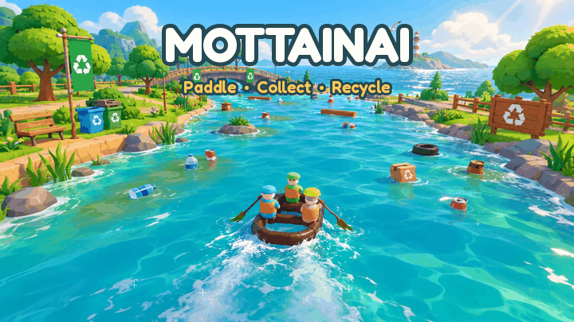
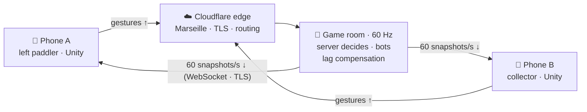
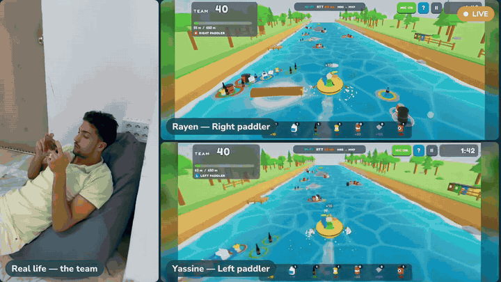

<div align="center">



# MOTTAINAI

### もったいない · *What a waste!*

**Paddle · Collect · Recycle**


</div>

---

## 🏆 Award

**🥉 3rd place at the Green Hackathon 2026**, Swedish-Tunisian Games and Innovation Days, 21–22 November 2026, Pôle Technologique El Ghazala, Tunisia.

> *« Rien ne se jette, tout s'invente »*: nothing is thrown away, everything is invented.

## 🌊 The problem

The Mediterranean, right now:

- **33,800** plastic bottles' worth of plastic pour into the Mediterranean **every minute**.
- That is **570,000 t** of plastic **every year**, into the sea we swim in every summer.
  <sub>Source: WWF, *Stop the Flood of Plastic* (2019)</sub>

And it's not just one sea:

| | |
|---|---|
| **353 Mt** | of plastic waste thrown away in one year (2019) |
| **9 %** | recycled. The other 91 % is burned, buried or leaks |
| **109 Mt** | already sitting in rivers, on their way to the sea |
| **×3 by 2060** | plastic waste almost triples if nothing changes (1,014 Mt) |

<sub>Source: OECD, *Global Plastics Outlook* (2022)</sub>

The generation that will inherit it is **7–12 years old**, the age when habits take shape. Sorting is taught on a blackboard… and rarely practised. Meanwhile, **3.4 B** people play video games <sub>(Newzoo, *Global Games Market Report* 2024)</sub>.

**What if the lesson lived where kids already play?**

## 💡 The idea

*Mottainai* (もったいない) is a Japanese word for the regret of wasting something precious: **"What a waste!"** That word became our game.

> **A real-time co-op mobile game: 3 players share 1 raft to clean a polluted river.**

## 🎮 Gameplay

Three players. One raft. Each phone controls one part of it, so nobody wins alone.

| Role | What you do | Gesture |
|---|---|---|
| 🚣 **Left paddler** | Paddles on the left side | Swipe **↓** to paddle · **↑** to brake |
| 🚣 **Right paddler** | Paddles on the right side | Swipe **↓** to paddle · **↑** to brake |
| 🥅 **Collector** | Throws the net at floating waste | **Tap** a waste item |

> ⚡ **SYNC BOOST:** both strokes within **0.25 s** → **+30 %** thrust. Cooperation is the controller.

Missing a friend? **Bots** fill empty seats: play with 1, 2 or 3 phones.

**Rules**

- ⏱️ **2:00** per run, instant rematch.
- 🦈 Dodge rocks, icebergs and **sharks**. **1 hit = game over.**
- 🫧 **Shield** pickup: immune to obstacles for 6 s.
- 🔥 **Combo:** 3 catches within 3 s → **×1.5** on the next catch.

| Waste | Bin colour | Points |
|---|---|---|
| 🧴 Plastic | 🟡 Yellow | +10 |
| 📦 Paper / cardboard | 🔵 Blue | +10 |
| 🫙 Glass | 🟢 Green | +15 |
| 🍌 Organic | 🟤 Brown | +5 |
| 🥫 Metal | ⚪ Grey | +20 |
| 💍 Valuable (rare) | ⭐ Gold | +100 |
| ☢️ Toxic | 🔴 Red | −30 |

At the end of each run: waste per bin, accuracy, and the **kilos of river you cleaned**.

## ⚖️ Learn × Play

Learning and fun, in perfect balance.

| 📚 Learn | 🎮 Play |
|---|---|
| 7 real recycling-bin colours | Co-op raft with a sync boost |
| Toxic waste = −30: a safety reflex | Combos ×1.5 & power-ups |
| Kilos of river cleaned, every run | Sharks, rocks & icebergs |
| Teamwork & coordination | 2-minute runs, instant rematch |

> **Kids play for the score, and leave with the habit.**

## 🚀 What makes it different

1. **Cooperation is the controller.** Sync your strokes within 0.25 s and the raft surges +30 %. The raft needs the whole crew.
2. **Real-time multiplayer on phones.** One authoritative game room per match, 60 Hz, on Cloudflare's edge.
3. **Built for 5G.** 5G SA / NSA detection, and a request for a low-latency network slice (Android 13+).
4. **A network lab inside the game.** Measures latency, jitter and bandwidth on every network, exported as CSV.

> **read · answer · forget → paddle · catch · remember**

## 🛠️ Under the hood



Phones only send gestures; the server decides everything (Cloudflare Worker + Durable Object per room).

| Measured | Value | Date |
|---|---|---|
| Snapshots to each phone | **60 /s** | 22 Nov 2026 (test match on Cloudflare) |
| Bandwidth per phone | **~226 kbps** | 22 Nov 2026 (test match on Cloudflare) |
| Round trip | **43–71 ms** | 22 Nov 2026 (phone Network Lab, Wi-Fi) |
| Frame rate | **60 fps** (60.1 avg) | 22 Nov 2026 (full match on our test phone) |

**Stack:** Unity 6 · C# · Android · Cloudflare Workers + Durable Objects (TypeScript) · WebSocket.

## 🎬 Demo

[](docs/media/MOTTAINAI_Demo.mp4)

<sub>Two real phones, one raft: Rayen (right paddler) and Yassine (left paddler) join room BCFJ, then paddle together down the river.</sub>

▶️ [Watch the full demo video (MP4)](docs/media/MOTTAINAI_Demo.mp4)

🎤 **Pitch presentation:** [rayentouil.github.io/Mottainai/presentation](https://rayentouil.github.io/Mottainai/presentation/) · source: [`docs/presentation/index.html`](docs/presentation/index.html)
<sub>Keys: Enter to start · Space / → next · F fullscreen · P presenter view · ? help</sub>

## ▶️ Run it

**Requirements:** Unity 6 (6000.x) with Android Build Support, Node.js, a free Cloudflare account, Windows (build scripts are `.bat`).

```bash
git clone https://github.com/RayenTouil/Mottainai.git
cd Mottainai
```

**1. Server (Cloudflare Worker + Durable Objects)**

```bash
cd server && npx wrangler login   # once per PC
cd .. && deploy_server.bat         # builds the content pack, deploys, writes the URL
                                   # into Mottainai/Assets/_Mottainai/Resources/server_config.json
```

- Local dev server: `cd server && npm run dev`
- Live logs: `cd server && npx wrangler tail`
- Checks: `node server/tools/smoke.ts` (connect + RTT) · `node server/tools/fakeclient.ts` (full 2:00 match) · `cd server && npm run simcheck` (20 bot matches offline)

**2. Android app**

```bash
build_android.bat    # close the Unity editor first → Builds\Mottainai.apk
install_phone.bat    # installs + launches on every USB-connected phone
```

In the app: name → **PLAY** → content pack download → **QUICK PLAY**. Three-finger tap shows the Net HUD.
More details: [`DEPLOY.md`](DEPLOY.md) and [`PROTOCOL.md`](PROTOCOL.md).

## 🗺️ Roadmap

| ✅ Now | ⏭️ Next | 🔭 Later |
|---|---|---|
| **Working prototype** | **Classroom pilot** | **Grow** |
| Co-op raft · 3 roles + bots · 60 Hz edge server | Quiz before / after · eco-tip per catch · sorting center · 5G SA test | New rivers & worlds · school leaderboards · team-vs-team battle mode |

**How we'll prove impact:** sorting accuracy per bin · quiz before vs after · sync rate.

## 👥 Team "5le9a Deyra"

SUP'COM engineering students.

| Member | Role |
|---|---|
| **Rayen TOUIL** | Pitch deck & presentation, 3D asset integration, main codebase |
| **Yassine AFFES** | Lead developer (server & networking), coder, second pitcher |
| **Med Amine CHAKROUN** | Coach |
| **Wajdi ZENTANI** | Pitcher & the team's saver |

## 🙏 Credits

- **3D models** from [Poly Pizza](https://poly.pizza): [Quaternius](https://quaternius.com) (CC0); *Soda Can* by jeremy, *Elm tree* and *Palm tree* by Poly by Google, *Pine Tree* by Danni Bittman, *Iceberg 1* by S. Paul Michael ([CC-BY 3.0](https://creativecommons.org/licenses/by/3.0/)). Full list: [`CREDITS.md`](Mottainai/Assets/_Mottainai/Resources/Models/CREDITS.md).
- **Fonts:** [Fredoka](https://fonts.google.com/specimen/Fredoka), [Nunito Sans](https://fonts.google.com/specimen/Nunito+Sans) ([SIL OFL](docs/presentation/assets/fonts/OFL.txt)).
- **Data:** WWF, *Stop the Flood of Plastic* (2019) · OECD, *Global Plastics Outlook* (2022) · Newzoo, *Global Games Market Report* (2024).

---

<div align="center">

**Every paddle counts. Every piece matters.** 💚

</div>
